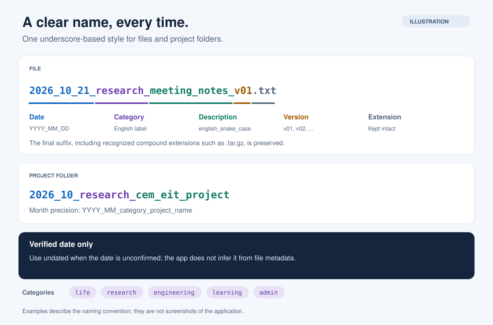
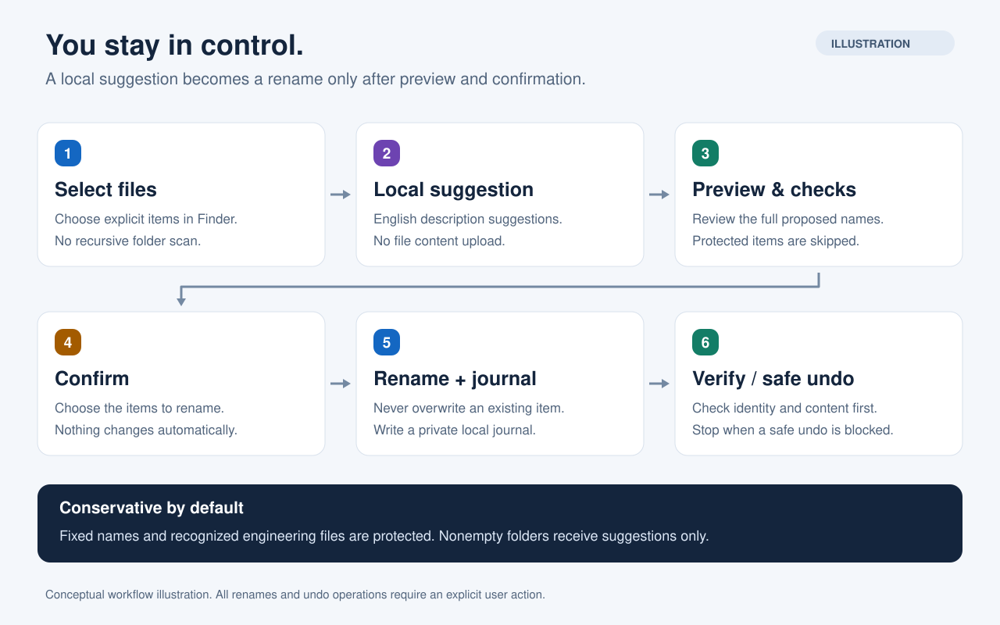

# Naming Assistant · 文件命名助手

为 macOS 上选中的独立文件生成统一的**日期 + 英文分类 + 英文简介**名称。基于 [MacRename](https://github.com/simcrauk/MacRename) 定制，以本地处理、预览确认和安全撤销为核心。

**当前版本：0.1.1 早期预览版 · Apple Silicon · 最低部署目标 macOS 14 · MIT**

[下载安装包](https://github.com/brownzhu/naming-assistant-macos/releases) · [完整使用说明](NAMING_ASSISTANT.md) · [后续改进](ROADMAP.md) · [安全说明](SECURITY.md) · [隐私说明](PRIVACY.md)

## 名称长什么样



*上图为命名规则示意，所有文件名均为虚构示例。*

| 对象 | 建议名称 |
| --- | --- |
| 文件 | `2026_10_21_research_meeting_notes_v01.pdf` |
| 项目目录 | `2026_10_research_cem_eit_project` |
| 日期尚未核实 | `undated_admin_residence_permit_application.PDF` |
| 复合后缀 | `2026_10_21_research_reconstruction_results_v01.nii.GZ` |

- 日期和词语均使用下划线，文件按日、项目目录按月命名。
- 分类为 `life`、`research`、`engineering`、`learning`、`admin`；分类由用户选择。
- 文件默认版本为 `_v01`，可以修改或清空；目录默认不加版本。
- **日期必须由用户核实后勾选。** 程序不会把下载时间、修改时间或今天自动当作资料日期；未确认时使用 `undated`。
- 保留原后缀及大小写，识别 `.tar.gz`、`.nii.GZ` 等已知复合后缀。未知复合后缀需人工复核。

## 怎样使用



*流程示意图，不是应用截图。生成建议和生成预览都不会执行改名。*

1. 添加或拖入需要处理的文件/文件夹；文件夹不会被展开扫描。
2. 为对象的**确切父目录**选择授权，只处理明确加入列表的对象。先确认文件名没有工程、链接或其他文档依赖；取消授权会跳过该目录。
3. 选择分类、核对英文简介与版本；资料日期确认后再勾选。
4. 点击“生成预览”，检查建议名称与保护原因，再明确确认改名。
5. 需要时使用“撤销上次操作”。重新启动后仍可读取本机记录；撤销也要重新核对对象和原位置。

### 英文建议如何产生

| 路径 | 当前行为 |
| --- | --- |
| 已有英文 | 规范化为小写 `snake_case` |
| 内置词典 | 少量明确的中文术语可转换，如 `会议记录` → `meeting_notes` |
| Apple 本机模型（可选） | 点击“本机生成英文建议”后，按原文件名主体生成简介；不读取正文来推断语义 |
| 模型不可用或未知中文 | 明确提示，退回词典或要求手动填写英文 |

Apple 模型需要 macOS 26+、兼容设备、已启用且就绪的 Apple Intelligence；应用会先检查实际可用性，不自动开启系统功能或下载模型。它只修改待核对的简介，不替用户决定日期/分类，也不自动改名。**本机模型的实际翻译质量尚未现场验收。**

## 安装与快捷键

1. 从 [Releases](https://github.com/brownzhu/naming-assistant-macos/releases) 下载 Apple Silicon ZIP，解压后将 `Naming Assistant.app` 放进 `/Applications` 或 `~/Applications`。
2. 打开应用，点击主窗口的 **“快捷键设置…”**，或选择应用菜单 **“设置…”（⌘,）**。设置窗口会显示推荐组合 **⌃⌥⌘N（Control + Option + Command + N）** 和服务名 **“建议标准名称 / Suggest Standard Names”**。
3. 点击 **“打开系统快捷键设置”**，再在系统中选择 **服务 → 文件和文件夹 → 建议标准名称**，为它设置推荐组合，或自行选择不冲突的组合。每台 Mac 配置一次。
4. 系统版本不同，按钮可能只打开键盘设置页。可使用备用 **“打开键盘设置”** 按钮，并按 **键盘快捷键 → 服务 → 文件和文件夹** 继续；手动路径为 **系统设置 → 键盘 → 键盘快捷键 → 服务 → 文件和文件夹**。
5. 在 Finder 中选中文件并按快捷键，应用即可按需启动并接收选择，无需一直运行。也可使用 Finder 的服务菜单。

跳转只帮助打开系统设置，**最终的快捷键绑定仍由你在系统中完成**，不保证直接定位某一条服务。应用内提供同一组合显示命名窗口；它不是读取任意软件当前文档的全局热键。应用不会修改系统快捷键。服务未出现时确认已安装至 Applications 并打开过；必要时注销后重新登录。

当前安装包使用 **ad-hoc 签名，尚未完成 Developer ID 签名与 Apple 公证**。首次启动可能被 macOS 阻止；请保留系统安全检查，或审阅源码后在本机构建。不要为安装关闭 Gatekeeper。系统也可能先要求确认“运行受限制服务”，随后仍需目录授权和应用内确认。

## 当前保护与限制

| 保护/范围 | 当前版本 |
| --- | --- |
| 覆盖与冲突 | 目标存在、大小写冲突或批次冲突时拒绝；内核排他改名 |
| 执行与撤销 | 再次检查身份及本地内容指纹；文件被修改/替换、原名被占用时拒绝相关操作 |
| 工程和固定名称 | 保护固定名称、源码/TeX 后缀、已识别工程标记、常见依赖目录和应用包 |
| 文件夹 | **仅允许独立空目录执行改名**；非空目录只提供建议 |
| 文件大小 | 普通文件最多 **512 MiB**；更大文件只提供建议 |
| 批次与链接 | 最多 500 个显式对象；不递归；拒绝符号链接、硬链接和特殊文件 |
| 历史 | 私有本机日志，含路径、身份及指纹，不保存正文；两台机器不要同步撤销日志 |

工程规则**无法识别所有自定义目录布局、引用图片或外部文档链接**。请先将工程资料复制为独立导出文件，再整理名称。安全校验会本地读取文件以计算 SHA256；AI 建议只接收文件名主体。应用没有云端上传、付费 AI 接口或全盘监控功能。

整个批次不是原子事务；中途失败可能有部分成功，工具保留结果与日志，不盲目回滚。中断恢复只核查状态。撤销受当前状态约束，不能防御同一账户下持续恶意替换文件的进程，也不替代备份。详见 [SECURITY.md](SECURITY.md)。

## 验证状态

- 0.1.0 基线的独立 Swift 6 回归：**75 项通过，0 项失败**，覆盖命名、冲突、对象变化、私有日志、中断恢复、工程保护及本地建议边界。
- 0.1.0 已对隔离样例完成 GUI 预览、改名、撤销、重启后撤销和 Finder 冷启动验证；未批量处理真实文档。
- 当前现场测试环境为 macOS 27.0.1 / Apple Silicon。macOS 14/15 和第二台实体 Mac 尚未进行 GUI 运行验收；最低部署目标不等于全部版本已验证。
- 本机模型在现场主机不可用，已验证词典回退和未知中文提示；未验证模型输出质量。中断测试为日志阶段模拟，未实际断电。

验证详情见 [docs/VALIDATION.md](docs/VALIDATION.md)。GitHub Actions 的构建与测试结果单独记录，不代表完成全部 GUI 验收。

## 后续准备改进

**计划，尚未实现，不承诺交付日期：**

- 下一阶段：跨系统/双机验收、正式签名与公证、更多中断测试、界面与无障碍改进。
- 命名体验：自定义词典、可导入导出的规则、批量编辑、更明确的日期来源与保护原因。
- 安全扩展研究：可配置工程保护根目录、引用关系检测、非空目录与大文件策略、本机模型质量评估。

完整分阶段计划与验收条件见 [ROADMAP.md](ROADMAP.md)。欢迎提交不含真实文件名、路径或文档内容的可复现实例。

## 从源码构建

需要 macOS、Swift 6 开发工具链和 Command Line Tools；支持 FoundationModels 的 SDK 才会编译可选模型路径，旧 SDK 保留词典回退。

```bash
git clone https://github.com/brownzhu/naming-assistant-macos.git
cd naming-assistant-macos
swift build --build-system native --product NamingAssistant
bash scripts/test-naming-safety.sh
bash scripts/package-naming-assistant.sh "$PWD/dist"
```

打包脚本拒绝覆盖已有 `.app`，去除本机调试路径后 ad-hoc 签名；不会安装应用、修改快捷键或删除隔离属性。构建系统可能联网下载 SwiftPM 依赖；应用运行没有上传文件内容的功能。

主代码位于 `Sources/NamingAssistantApp`、`Sources/MacRenameCore/Naming` 和 `Sources/MacRenameCore/Safety`。保留的旧 Quick Rename GUI/CLI 与 Finder Sync 源码目标不属于当前应用交付，旧安装脚本也不是 Naming Assistant 的安装入口。贡献前请读 [CONTRIBUTING.md](CONTRIBUTING.md)。

## 上游与许可

本项目基于 [simcrauk/MacRename](https://github.com/simcrauk/MacRename)，起始提交 `3cdb3eb`；保留 Simon Craig 的 MIT 版权与 [LICENSE](LICENSE)。变更和上游关系见 [UPSTREAM.md](UPSTREAM.md)，历史 README 保存在 [docs/upstream/README.md](docs/upstream/README.md)，其中功能描述仅属于上游产品。
