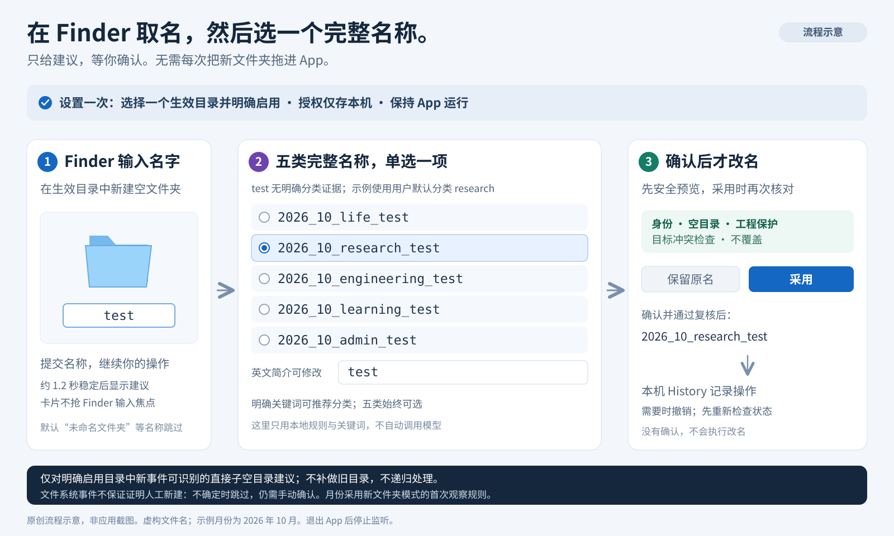

# Naming Assistant · 文件命名助手

在 Finder 新建空文件夹后显示命名建议，也可批量整理选中的独立文件。名称统一为**日期 + 英文分类 + 英文简介**。基于 [MacRename](https://github.com/simcrauk/MacRename) 定制，以本地处理、预览确认和安全撤销为核心。

**当前版本：0.3.0 早期预览版 · Apple Silicon · 最低部署目标 macOS 14 · MIT**

0.3.0 新增分类与词语转换两个编辑器；下载页以实际发布版本为准。

[下载安装包](https://github.com/brownzhu/naming-assistant-macos/releases) · [完整使用说明](NAMING_ASSISTANT.md) · [后续改进](ROADMAP.md) · [安全说明](SECURITY.md) · [隐私说明](PRIVACY.md)

## 名称长什么样


*上图为命名规则示意，所有文件名均为虚构示例。*

| 对象 | 建议名称 |
| --- | --- |
| 文件 | `2026_10_21_research_meeting_notes_v01.pdf` |
| 项目目录 | `2026_10_research_cem_eit_project` |
| 日期尚未核实 | `undated_admin_residence_permit_application.PDF` |
| 复合后缀 | `2026_10_21_research_reconstruction_results_v01.nii.GZ` |

- 日期和词语均使用下划线，文件按日、项目目录按月命名。
- 初始提供 `life`、`research`、`engineering`、`learning`、`admin` 五类；可自定义分类名称、英文标记、关键词、显示数量、顺序与默认项。分类总数为 1–20，至少显示一项。
- 文件默认版本为 `_v01`，可以修改或清空；目录默认不加版本。
- **已有资料的日期必须由用户核实后勾选。** 批量模式不会把下载时间、修改时间或今天自动当作资料日期；未确认时使用 `undated`。新文件夹模式采用明确启用的“新建月份”规则，与资料日期分开。
- 保留原后缀及大小写，识别 `.tar.gz`、`.nii.GZ` 等已知复合后缀。未知复合后缀需人工复核。

## 怎样使用

### Finder 新文件夹建议：不用再拖进 App



*原创流程示意，非应用截图。图中五类是初始默认配置；0.3.0 可修改分类与显示数量。`test` 没有明确分类证据；示例使用用户默认的 `research`，仍可选择其他显示的分类。*

1. 打开 App 的“设置…”（⌘,），在“新文件夹建议”中选择**一个生效目录**并明确启用。所选目录的授权书签只保存在本机，以后不必每次选择。
2. 保持 App 运行。在这个目录中用 Finder 新建空文件夹，输入如 `test` 并提交名称。
3. 名称稳定约 **1.2 秒**后，助手显示不抢 Finder 输入焦点的独立建议卡。它不是接管 Finder 原生命名框，也不会监听或吞掉 Finder 的回车键。
4. 卡片按设置的顺序显示分类完整名称，数量较多时可滚动，**单选一项**，需要时修改英文简介，再点“采用”。初始五类例如：

   ```text
   2026_10_life_test
   2026_10_research_test
   2026_10_engineering_test
   2026_10_learning_test
   2026_10_admin_test
   ```

5. 建议先经过身份、空目录、工程保护与冲突预览；只有点击“采用”并通过执行前复核后，才执行排他改名并写入原有本机历史。可保留原名；没有确认就不会改名。撤销仍使用同一 History 和状态核验。

明确关键词会产生可修改的分类提示，例如初始规则中 `invoice` → `admin`、`study_notes` → `learning`。关键词可编辑；`test`、未知词或分类证据相同的输入使用设置中的默认项，不会被伪装成确定判断。所有已显示分类均可选择。新文件夹卡片只用本地规则/词典和关键词提示，不自动调用模型。

此模式明确采用**首次观察确认的新建月份**，例如在 2026 年 10 月新建则使用 `2026_10`。它只对启用后可信创建事件可识别的**直接子空目录**给建议：启动时仅记录现有直接子项的名称/身份作为排除基线，不补做旧目录，不递归枚举内容；默认“未命名文件夹”等占位名会跳过。

文件系统事件无法证明所有新目录一定由人手动新建。移动、复制、解压或事件合并可能产生相似现象，因此宁可漏提示，也始终保留手动确认；不承诺完全识别创建来源。事件丢失、根目录身份或访问权限变化时暂停，需重新检查/启用。当前仅支持一个根目录。

App 必须运行；关闭主窗口可继续，退出后立即停止。菜单栏可暂停、进入设置或打开主窗口，不会自动设置登录启动项。卡片不在眼前时，可从应用菜单“查看当前文件夹建议…”或菜单栏“查看当前建议…”找回并明确聚焦当前建议。

### 批量处理已有文件


*上图说明批量处理流程，不是应用截图。两种模式都先给建议并等待确认。*

1. 添加或拖入需要处理的文件/文件夹；文件夹不会被展开扫描。
2. 为对象的**确切父目录**选择授权，只处理明确加入列表的对象。先确认文件名没有工程、链接或其他文档依赖；取消授权会跳过该目录。
3. 选择分类、核对英文简介与版本；资料日期确认后再勾选。
4. 点击“生成预览”，检查建议名称与保护原因，再明确确认改名。
5. 需要时使用“撤销上次操作”。重新启动后仍可读取本机记录；撤销也要重新核对对象和原位置。

### 自定义分类与词语转换

在设置中打开“编辑分类词…”或“词语转换词典…”：

- **分类编辑器：** 初始五类可修改，也可添加、删除、隐藏和排序。共支持 1–20 类，至少显示一类；默认项必须是已显示分类。可编辑显示名称、用于文件名的英文标记及推荐关键词。隐藏只减少显示数量，保留该项配置。批量窗口与新文件夹卡片共用这些分类。
- **词典编辑器：** 每行一条 `原词 = english_snake_case`，最多 100 条。当前词典完整展示，可新增、修改或删除，包括初始内置词。删除后本地词典不会从另一份隐藏的内置表找回该转换；点击“恢复内置词典”并保存才恢复默认表。
- 两个编辑器均在保存前验证格式，只将设置保存到本机 `UserDefaults`。保存设置不会执行改名或修改历史；不自动同步到另一台 Mac。

例如增加“客户资料”分类，英文标记为 `client_work`，再加入 `客户简报 = client_brief`，可得到 `2026_10_client_work_client_brief`。英文标记只允许小写字母、数字与单个下划线，以小写字母开头，最多 24 字节，不能以下划线结尾。显示名称不必成为文件名的一部分。

### 英文建议如何产生

| 路径 | 当前行为 |
| --- | --- |
| 已有英文 | 规范化为小写 `snake_case` |
| 可编辑本地词典 | 初始提供少量转换，如 `会议记录` → `meeting_notes`；使用当前保存的完整词典，显式配置的有效转换优先 |
| Apple 本机模型（可选） | 未得到完整本地词典转换时，点击“本机生成英文建议”才会按原文件名主体尝试；不读取正文来推断语义 |
| 模型不可用或未知中文 | 明确提示，使用当前词典或要求手动填写英文；未知部分不会被静默丢弃 |

Apple 模型需要 macOS 26+、兼容设备、已启用且就绪的 Apple Intelligence；应用会先检查实际可用性，不自动开启系统功能或下载模型。它只修改待核对的简介，不替用户决定日期/分类，也不自动改名。**本机模型的实际翻译质量尚未现场验收。**

## 安装与快捷键

1. 从 [Releases](https://github.com/brownzhu/naming-assistant-macos/releases) 下载 Apple Silicon ZIP，解压后将 `Naming Assistant.app` 放进 `/Applications` 或 `~/Applications`。
2. 打开应用，点击主窗口或应用菜单的 **“快捷键设置…”**，会直接进入设置的 **“快捷键”** 页；通过 **“设置…”（⌘,）** 打开时默认进入“新文件夹建议”，请切换到“快捷键”页。该页显示推荐组合 **⌃⌥⌘N（Control + Option + Command + N）** 和服务名 **“建议标准名称 / Suggest Standard Names”**。
3. 点击 **“打开系统快捷键设置”**，再在系统中选择 **服务 → 文件和文件夹 → 建议标准名称**，为它设置推荐组合，或自行选择不冲突的组合。每台 Mac 配置一次。
4. 系统版本不同，按钮可能只打开键盘设置页。可使用备用 **“打开键盘设置”** 按钮，并按 **键盘快捷键 → 服务 → 文件和文件夹** 继续；手动路径为 **系统设置 → 键盘 → 键盘快捷键 → 服务 → 文件和文件夹**。
5. 在 Finder 中选中文件并按快捷键，应用即可按需启动并接收选择，无需一直运行。也可使用 Finder 的服务菜单。

跳转只帮助打开系统设置，**最终的快捷键绑定仍由你在系统中完成**，不保证直接定位某一条服务。应用内提供同一组合显示命名窗口；它不是读取任意软件当前文档的全局热键。应用不会修改系统快捷键。服务未出现时确认已安装至 Applications 并打开过；必要时注销后重新登录。

当前安装包使用 **ad-hoc 签名，尚未完成 Developer ID 签名与 Apple 公证**。首次启动可能被 macOS 阻止；请保留系统安全检查，或审阅源码后在本机构建。不要为安装关闭 Gatekeeper。系统也可能先要求确认“运行受限制服务”，随后仍需目录授权和应用内确认。

## 当前保护与限制

| 保护/范围 | 当前版本 |
| --- | --- |
| 覆盖与冲突 | 目标存在、大小写冲突或批次冲突时拒绝；内核排他改名 |
| 执行与撤销 | 再次检查身份及本地内容指纹；文件被修改/替换、原名被占用时拒绝相关操作 |
| 工程和固定名称 | 保护固定名称、源码/TeX 后缀、已识别工程标记、常见依赖目录和应用包 |
| 文件夹 | **仅允许独立空目录执行改名**；非空目录不执行，新文件夹监听也不会处理非空目录 |
| 文件大小 | 普通文件最多 **512 MiB**；更大文件只提供建议 |
| 批次与链接 | 批量模式最多 500 个显式对象；不递归；拒绝符号链接、硬链接和特殊文件 |
| 新文件夹建议 | 明确启用的一个根目录，只考虑新创建事件可识别的直接子空目录；异常暂停、不补做旧对象 |
| 授权 | 新文件夹根目录的 security-scoped bookmark 仅保存在本机；可在设置中停用/移除，不云同步 |
| 历史 | 私有本机日志，含路径、身份及指纹，不保存正文；两台机器不要同步撤销日志 |
| 自定义设置 | 分类和完整词典经格式验证后保存在本机 `UserDefaults`；不会绕过原有预览、授权或执行保护 |

工程规则**无法识别所有自定义目录布局、引用图片或外部文档链接**。请先将工程资料复制为独立导出文件，再整理名称。安全校验会本地读取文件以计算 SHA256；AI 建议只接收文件名主体。新文件夹模式只监控明确选择并启用的根目录，应用没有云端上传、付费 AI 接口或全盘监控功能。

整个批次不是原子事务；中途失败可能有部分成功，工具保留结果与日志，不盲目回滚。中断恢复只核查状态。撤销受当前状态约束，不能防御同一账户下持续恶意替换文件的进程，也不替代备份。详见 [SECURITY.md](SECURITY.md)。

## 验证状态

0.3.0 已在当前 macOS 27.0.1 / Apple Silicon 主机完成隔离验证：

- 独立 Swift 6 安全回归 **128 项通过，0 项失败**；真实 FSEvents 事件回归 **8 项通过，0 项失败**，包括自定义分类标准名称的排除。
- Debug/Release 应用构建和签名检查通过；签名仍为 ad-hoc，不代表 Apple 公证。
- GUI 添加第六类“客户 / client_work”、编辑关键词，隐藏两类后显示四类；修改完整词典并保存。退出重启后，新建虚构的“客户提案”显示四个候选，自动推荐客户分类，简介为 `client_proposal`。
- 确认采用得到 `2026_10_client_work_client_proposal`，核对目录仍为空；主窗口确认撤销后恢复“客户提案”。测试根目录授权已移除。具体步骤见 [验证记录](docs/VALIDATION.md)。

下方保留 **0.2.0 历史记录**；它与新版编辑器的上述验证分别记录：

0.2.0 已在当前现场主机完成以下独立验证；所有文件操作均使用隔离的临时样例。具体步骤和范围见 [验证记录](docs/VALIDATION.md)。

- 0.2.0 独立 Swift 6 安全回归：**103 项通过，0 项失败**，包括原有命名/执行/撤销保护、新文件夹对象观察与身份验证、关键词分类边界。
- 真实 FSEvents 隔离事件测试：**7 项通过，0 项失败**；只使用临时构造的目录与文件。
- GUI 已通过设置双页、目录授权、重启后恢复本机 bookmark，以及移除目录授权后停止监听。
- Finder GUI 已通过实际新建/输入 → 被动建议队列 → 菜单找回并检查五类完整名称 → 选择 `engineering` 并采用 → 退出重启后从 History 确认撤销；Finder 核对改名和原名恢复，目录保持为空。未知名称仅显示默认分类，没有伪造关键词推荐。
- 0.1.0 已对隔离样例完成 GUI 预览、改名、撤销、重启后撤销和 Finder 冷启动验证；未批量处理真实文档。
- 当前现场测试环境为 macOS 27.0.1 / Apple Silicon。macOS 14/15 和第二台实体 Mac 尚未进行 GUI 运行验收；最低部署目标不等于全部版本已验证。
- 本机模型在现场主机不可用，已验证词典回退和未知中文提示；未验证模型输出质量。中断测试为日志阶段模拟，未实际断电。

验证详情见 [docs/VALIDATION.md](docs/VALIDATION.md)。GitHub Actions 的构建与测试结果单独记录，不代表完成全部 GUI 验收。

## 后续准备改进

**计划，尚未实现，不承诺交付日期：**

- 下一阶段：跨系统/双机验收、正式签名与公证、更多中断测试、界面与无障碍改进。
- 命名体验：分类与词典规则导入/导出、两台机器间显式迁移、批量编辑、更明确的日期来源与保护原因。分类和词典的本机编辑器已纳入 0.3.0，验收状态见上文。
- 安全扩展研究：可配置工程保护根目录、引用关系检测、非空目录与大文件策略、本机模型质量评估。

完整分阶段计划与验收条件见 [ROADMAP.md](ROADMAP.md)。欢迎提交不含真实文件名、路径或文档内容的可复现实例。

## 从源码构建

需要 macOS、Swift 6 开发工具链和 Command Line Tools；支持 FoundationModels 的 SDK 才会编译可选模型路径，旧 SDK 保留词典回退。

```bash
git clone https://github.com/brownzhu/naming-assistant-macos.git
cd naming-assistant-macos
swift build --build-system native --product NamingAssistant
bash scripts/test-naming-safety.sh
bash scripts/test-folder-assist-monitor.sh
bash scripts/package-naming-assistant.sh "$PWD/dist"
```

打包脚本拒绝覆盖已有 `.app`，去除本机调试路径后 ad-hoc 签名；不会安装应用、修改快捷键或删除隔离属性。构建系统可能联网下载 SwiftPM 依赖；应用运行没有上传文件内容的功能。

主代码位于 `Sources/NamingAssistantApp`、`Sources/MacRenameCore/Naming` 和 `Sources/MacRenameCore/Safety`。保留的旧 Quick Rename GUI/CLI 与 Finder Sync 源码目标不属于当前应用交付，旧安装脚本也不是 Naming Assistant 的安装入口。贡献前请读 [CONTRIBUTING.md](CONTRIBUTING.md)。

## 上游与许可

本项目基于 [simcrauk/MacRename](https://github.com/simcrauk/MacRename)，起始提交 `3cdb3eb`；保留 Simon Craig 的 MIT 版权与 [LICENSE](LICENSE)。变更和上游关系见 [UPSTREAM.md](UPSTREAM.md)，历史 README 保存在 [docs/upstream/README.md](docs/upstream/README.md)，其中功能描述仅属于上游产品。
